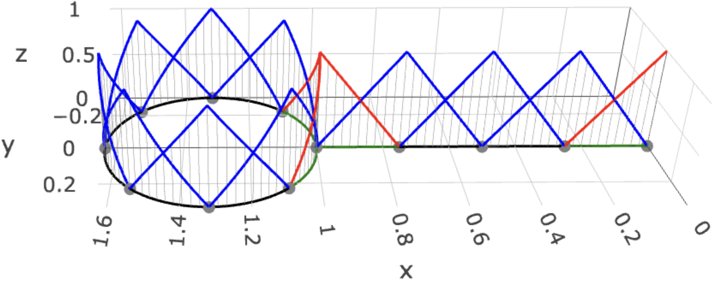
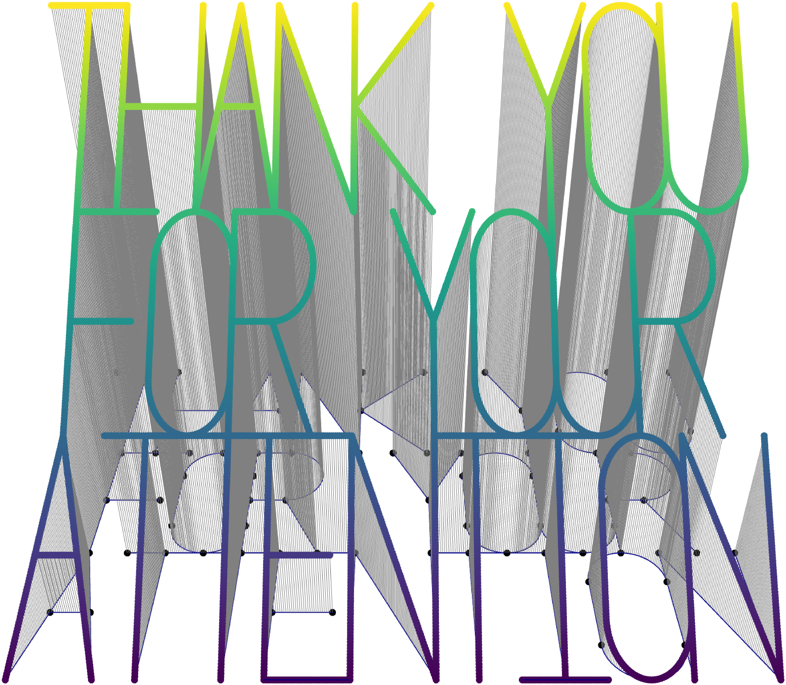

```{r setup, include=FALSE}
# Use the existing theme as-is: do not regenerate the shared CSS.
knitr::opts_chunk$set(echo=FALSE, message=FALSE, warning=FALSE,
  error=FALSE, cache=FALSE, fig.align="center", dpi=180,
  fig.width=9, fig.height=3.7, out.width="94%")
options(htmltools.dir.version=FALSE)

# Give the automatically generated cover its presenter script before remark starts.
# The script comes from title-notes in the YAML header and changes notes only.
cover_notes <- trimws(rmarkdown::metadata[["title-notes"]])
notes_script <- "data_files/tuesdaymeeting2p/title-notes.js"
notes_js <- paste0(
  "(function(){var source=document.getElementById('source');",
  "source.value=source.value.replace(/^---$/m,function(){return ",
  jsonlite::toJSON(paste0("???\n",cover_notes,"\n\n---"),auto_unbox=TRUE),
  ";});source.textContent=source.value;})();")
writeLines(notes_js,notes_script)
notes_docs_script <- file.path("docs",notes_script)
dir.create(dirname(notes_docs_script),recursive=TRUE,showWarnings=FALSE)
stopifnot(file.copy(notes_script,notes_docs_script,overwrite=TRUE))

# Figures are generated manually by scripts/generate_tuesdaymeeting2p_plots.R.
# Knitting loads the saved images and slope summaries without rebuilding plots.
plot_dir <- "data_files/tuesdaymeeting2p/convergence-plots"
plot_summary <- readRDS(file.path(plot_dir,"plot-summary.rds"))
tau_rates <- plot_summary$temporal_rates
h_rates <- plot_summary$spatial_rates
```

```{r, load_refs, include=FALSE, cache=FALSE}
library(RefManageR)
BibOptions(check.entries = FALSE,
           bib.style = "authoryear",
           cite.style = "alphabetic",
           style = "markdown",
           hyperlink = FALSE,
           dashed = FALSE)
myBib <- ReadBib("./presentation_ref.bib", check = FALSE)
```

```{r captions, include=FALSE}
fig_count <- 0
captioner <- function(caption) {
  fig_count <<- fig_count + 1
  paste0("Figure ", fig_count, ": ", caption)
}
```


class: left, top

<div style="position:absolute; top:40px; right:55px;">
  
  
  
</div>

### Problem setting 1/4
*********


On a compact, connected graph $\Gamma$, we consider the fractional model

.content-box-blue[
$$\begin{cases}
\partial_tu(s,t)+L^{\alpha/2}u(s,t)=f(s,t),&(s,t)\in\Gamma\times(0,T),\\
u(s,0)=u_0(s),&s\in\Gamma,
\end{cases}\qquad L=\kappa^2-\Delta_\Gamma.\tag{1}$$
]

Here $\kappa>0$ and $0<\alpha\le2$. The Kirchhoff–Laplacian acts edgewise, and its domain couples the edges through continuity at each vertex and the Kirchhoff condition, which expresses conservation of flux.

$$D(L)=\left\{v\in\bigoplus_{e\in E}H^2(e):\begin{array}{l}
v\text{ is continuous on }\Gamma,\\[2pt]
\displaystyle\sum_{s\in w}\partial v(s)=0
\quad\text{at every vertex }w
\end{array}\right\}.\tag{2}$$

The sum includes both endpoints of a loop. These vertex conditions determine the operator whose spectral powers govern fractional diffusion.

???
We consider diffusion along the edges of a metric graph, with conditions at the vertices connecting those edges. The operator domain requires edgewise $H^2$ regularity so that the second derivative and endpoint derivatives make sense. Continuity joins the edge values, while the Kirchhoff condition expresses conservation of flux. These conditions determine $L$ and, through its spectrum, its fractional powers. Before defining those powers, the next two animations give a picture of how temperature evolves on a graph.

---

class: left, top

<div class="meeting-logos">
  
  
  
</div>

### Problem setting 2/4
*********

```{r p5plotly, eval = TRUE, fig.height = 5, out.width = "100%"}
load(here::here("data_files/logo_five_diffusion_animation.RData"))
# Keep animation frames outside remark's slide source so the deck opens quickly.
widget_file <- here::here("data_files/logo_five_diffusion_animation.html")
local({
  widget_libdir <- tempfile("logo_diffusion_libs_", tmpdir=dirname(widget_file))
  on.exit(unlink(widget_libdir, recursive=TRUE), add=TRUE)
  htmlwidgets::saveWidget(logo_five_diffusion_animation, widget_file,
    selfcontained=TRUE, libdir=widget_libdir, title="Diffusion on the logo graph")
})
docs_widget_file <- here::here("docs", "data_files", basename(widget_file))
dir.create(dirname(docs_widget_file), recursive=TRUE, showWarnings=FALSE)
stopifnot(file.copy(widget_file, docs_widget_file, overwrite=TRUE))
htmltools::tags$iframe(
  src=file.path("data_files", basename(widget_file)), width="100%",
  height=round(knitr::opts_current$get("fig.height")*96),
  style="border:0; display:block;", loading="lazy",
  title="Interactive diffusion animation")
```

???
For an introductory example, this animation uses ordinary diffusion with $\alpha=2$ and $\kappa=0$. Five Gaussian hot spots spread along the graph and through its junctions. The peaks flatten as temperature becomes more uniform within each connected component, while total heat stays constant. Height and colour both represent temperature. The two curves compare independently computed solutions on meshes with $h=0.1$ and $h=1$, and the markers identify the coarse nodes. Next, we change the operator to a fractional one.

---

class: left, top

<div class="meeting-logos">
  
  
  
</div>

### Problem setting 3/4
*********

```{r fractional-diffusion-animation, eval = TRUE, fig.height = 5, out.width = "100%"}
load(here::here("data_files/logo_five_fractional_diffusion_animation.RData"))
# Keep animation frames outside remark's slide source so the deck opens quickly.
fractional_widget_file <- here::here("data_files/logo_five_fractional_diffusion_animation.html")
local({
  fractional_widget_libdir <- tempfile("logo_diffusion_libs_", tmpdir=dirname(fractional_widget_file))
  on.exit(unlink(fractional_widget_libdir, recursive=TRUE), add=TRUE)
  htmlwidgets::saveWidget(logo_five_fractional_diffusion_animation, fractional_widget_file,
    selfcontained=TRUE, libdir=fractional_widget_libdir, title="Fractional diffusion on the logo graph")
})
fractional_docs_widget_file <- here::here("docs", "data_files", basename(fractional_widget_file))
dir.create(dirname(fractional_docs_widget_file), recursive=TRUE, showWarnings=FALSE)
stopifnot(file.copy(fractional_widget_file, fractional_docs_widget_file, overwrite=TRUE))
htmltools::tags$iframe(
  src=file.path("data_files", basename(fractional_widget_file)), width="100%",
  height=round(knitr::opts_current$get("fig.height")*96),
  style="border:0; display:block;", loading="lazy",
  title="Interactive fractional diffusion animation")
```

???
The second animation starts from the same five hot spots, now with $\alpha=1$ and $\kappa=1$. The fractional power gives a nonlocal operator within each connected component, while the positive shift also makes the heat decay. That decay is the clearest visible effect here. Since both parameters change, this animation does not isolate nonlocal transport. The fine and coarse solutions again illustrate spatial resolution. We now return to the mathematical definition of the fractional operator.

---

class: left, top

<div style="position:absolute; top:40px; right:55px;">
  
  
  
</div>

### Problem setting 4/4
*********


The positive, self-adjoint operator $L$ has compact inverse. Its eigenfunctions $e_j\in D(L)$ form an orthonormal basis of $L_2(\Gamma)$, with $Le_j=\lambda_je_j$.

.content-box-blue[
\begin{align*}
L^{s/2}v&=\sum_j\lambda_j^{s/2}(v,e_j)e_j,
\qquad \dot H^s(\Gamma)=D(L^{s/2}),\quad s\ge0,\\
\|v\|_{\dot H^s(\Gamma)}^2&=\sum_j\lambda_j^s|(v,e_j)|^2.
\end{align*}
]

Negative-order spaces are defined by duality. The spectral definition then gives, for every $r\in\mathbb R$,
\begin{equation*}
L^{\alpha/2}:\dot H^{r+\alpha}(\Gamma)\to\dot H^r(\Gamma),
\qquad \|L^{\alpha/2}v\|_{\dot H^r(\Gamma)}=\|v\|_{\dot H^{r+\alpha}(\Gamma)}.
\end{equation*}

On each space in this scale, $-L^{\alpha/2}$ generates the analytic semigroup
\begin{equation}
T(t)v=e^{-tL^{\alpha/2}}v=\sum_j e^{-t\lambda_j^{\alpha/2}}(v,e_j)e_j.\tag{3}
\end{equation}

???
With the vertex conditions fixed, the spectrum gives meaning to fractional powers of $L$. Each eigenfunction satisfies those conditions, and applying a fractional power multiplies its coefficient by the corresponding power of its eigenvalue. The required weighted summability defines $\dot H^s(\Gamma)$. Higher indices demand greater regularity, while duality gives negative indices. Applying $L^{\alpha/2}$ lowers the index by $\alpha$. Finally, exponential decay of the eigenmodes defines the analytic semigroup, which we use next to construct the evolving solution.

---

class: left, top

<div style="position:absolute; top:40px; right:55px;">
  
  
  
</div>

### Existence and uniqueness
*********


On the spectral scale, the evolution equation is:
\begin{equation}
\partial_tu+L^{\alpha/2}u=f\quad\text{in }\dot H^r(\Gamma),
\qquad u(0)=u_0.\tag{4}
\end{equation}

<div class="content-box-myblue">Theorem 1</div>

.content-box-blue[
For $\alpha>0$ and $r\in\mathbb R$, data satisfying
$u_0\in\dot H^{r+\alpha/2}(\Gamma)$ and $f\in L_2(0,T;\dot H^r(\Gamma))$ give the unique mild solution
\begin{equation}
u(t)=T(t)u_0+\int_0^tT(t-s)f(s)\,ds,\qquad t\in[0,T].\tag{5}
\end{equation}
Its regularity is $u\in L_2(0,T;\dot H^{r+\alpha}(\Gamma))\cap H^1(0,T;\dot H^r(\Gamma))\cap C([0,T];\dot H^{r+\alpha/2}(\Gamma))$. Equation (4) holds strongly in $\dot H^r(\Gamma)$ almost everywhere.
]

For $r\ge-\alpha/2$, the solution satisfies the weak formulation with $\mathfrak a_\alpha(v,w)=(L^{\alpha/4}v,L^{\alpha/4}w)_{L_2(\Gamma)}$:
\begin{equation}
\langle\partial_tu,v\rangle+\mathfrak a_\alpha(u,v)=\langle f,v\rangle,
\quad v\in\dot H^{\alpha/2}(\Gamma),\qquad u(0)=u_0.\tag{6}
\end{equation}

???
The semigroup now gives a solution for the initial condition, and the integral accounts for the forcing accumulated over time. The theorem guarantees uniqueness and states the regularity available from the data. We can formulate the equation in $\dot H^r(\Gamma)$ because the operator maps $\dot H^{r+\alpha}(\Gamma)$ into that space. When $r\ge-\alpha/2$, the solution also satisfies the weak formulation below. Its energy form provides the connection between the continuous problem and the numerical discretization.

---

class: left, top

<div style="position:absolute; top:40px; right:55px;">
  
  
  
</div>

### Discretization · Space 1/2
*********


The spatial approximation uses a conforming, quasi-uniform mesh $\mathcal T_h$, with a node at every graph vertex. Continuous P1 hats $\{\psi_i\}_{i=1}^{N_h}$ span the space $V_h\subset H^1(\Gamma)$.

The $L_2(\Gamma)$-orthogonal projection onto $V_h$ is denoted by $P_h$. It supplies the discrete initial value and load.

```{r spatial-basis, out.width='50%', fig.cap=captioner("Continuous P1 basis on the tadpole graph. Interior hats are blue and vertex hats are red.")}

```

???
We approximate the graph with a mesh that includes every graph vertex. Continuous piecewise linear hats then span the finite element space. The figure shows how ordinary interior hats and hats at graph vertices fit together while preserving continuity across junctions. The projection $P_h$ transfers the initial condition and source into this space using the $L_2(\Gamma)$ inner product. With the approximation space defined, we can construct the discrete operator and then take its fractional powers.

---

class: left, top

<div style="position:absolute; top:40px; right:55px;">
  
  
  
</div>

### Discretization · Space 2/2
*********


The finite-element approximation begins with the second-order operator $L$. Its fractional power is then defined in the discrete eigenbasis.

<div class="content-box-myblue">Definition 1</div>

.content-box-blue[
The operator $L_h:V_h\to V_h$ is defined using $L_2(\Gamma)$ inner products:
\begin{equation}
(L_hv_h,w_h)=\kappa^2(v_h,w_h)+(v_h',w_h'),\qquad v_h,w_h\in V_h.\tag{7}
\end{equation}
For $\beta=\alpha/2$, its spectral power is
\begin{equation*}
L_h^\beta v_h=\sum_{j=1}^{N_h}\lambda_{j,h}^{\beta}(v_h,e_{j,h})e_{j,h}.
\end{equation*}
]

The discrete energy form is defined by the same spectral construction:
\begin{equation*}
\mathfrak a_{h,\alpha}(v_h,w_h)
=(L_h^{\alpha/4}v_h,L_h^{\alpha/4}w_h)_{L_2(\Gamma)},
\qquad v_h,w_h\in V_h.
\end{equation*}

???
We first approximate the second-order operator $L$ through its usual finite element bilinear form. This defines $L_h$ entirely inside the finite-dimensional space. We then use the discrete eigenpairs to define its fractional powers, following the same construction as for the continuous operator. These powers also define the discrete energy form at the bottom. The order of construction matters because the spatial scheme uses the fractional power of $L_h$. Next, we discretize the evolution in time.

---

class: left, top

<div style="position:absolute; top:40px; right:55px;">
  
  
  
</div>

### Discretization · Time
*********


Backward Euler approximates the evolution on intervals $I_{k+1}=(t_k,t_{k+1}]$, where $\tau=T/N$. The forcing only needs to belong to $L_2(0,T;L_2(\Gamma))$, so its contribution is represented by a time average:

.content-box-blue[
\begin{equation*}
f^{k+1}=\frac1\tau\int_{t_k}^{t_{k+1}}f(t)\,dt,
\qquad \delta U^{k+1}=\frac{U^{k+1}-U^k}{\tau}.
\end{equation*}
]

The new state represents the solution throughout its time interval:
\begin{equation*}
\widetilde U^\tau(t)=U^k\quad\text{for }t\in(t_{k-1},t_k],
\qquad \widetilde U^\tau(0)=U^0.
\end{equation*}

This reconstruction identifies the weighted discrete time norm with the continuous space–time norm:
\begin{equation*}
\|\widetilde U^\tau\|_{L_2(0,T;L_2(\Gamma))}^2
=\tau\sum_{k=1}^N\|U^k\|_{L_2(\Gamma)}^2
=\|U^\tau\|_{\ell^2(L_2(\Gamma))}^2.
\end{equation*}

???
Backward Euler advances the solution one time interval at a time. Since the source only needs square-integrability in time, we use its average over each interval. We then interpret each computed state as constant throughout that interval. This reconstruction lets us compare the numerical trajectory with the continuous solution in a common space-time norm. The final identity shows that integrating this reconstruction gives exactly the weighted discrete time norm. That connection allows the error estimates to describe the quantity used in the experiments.

---

class: left, top

<div style="position:absolute; top:40px; right:55px;">
  
  
  
</div>

### Approximation · Temporal
*********


Applying backward Euler to the weak problem gives the time-discrete solution $U^{k+1}\in\dot H^{\beta}(\Gamma)$, with $\beta=\alpha/2$:
\begin{equation}
(\delta U^{k+1},v)+\mathfrak a_\alpha(U^{k+1},v)
=(f^{k+1},v),\qquad U^0=u_0,\quad v\in\dot H^{\beta}(\Gamma).\tag{8}
\end{equation}

The averaged source makes this scheme meaningful under the same temporal regularity as the continuous problem.

<div class="content-box-myblue">Theorem 2</div>

.content-box-blue[
For $\alpha>0$, $u_0\in\dot H^{\alpha/2}(\Gamma)$ and $f\in L_2(0,T;L_2(\Gamma))$ imply
\begin{equation*}
\|u-\widetilde U^\tau\|_{L_2(0,T;L_2(\Gamma))}\lesssim\tau.
\end{equation*}
]

Thus the piecewise constant reconstruction is first-order accurate in time, with a constant independent of $\tau$.

???
We first examine time discretization while leaving space continuous. Backward Euler replaces the time derivative by a difference quotient and uses the averaged source introduced earlier. Under the stated regularity of the initial condition and forcing, the theorem bounds the space-time error by a constant times $\tau$. This gives first-order convergence in time, with a constant independent of the time step. We can now hold this time-discrete problem fixed and examine what changes when we introduce the finite element space.

---

class: left, top

<div style="position:absolute; top:40px; right:55px;">
  
  
  
</div>

### Approximation · Spatial
*********


Combining the discrete energy form $\mathfrak a_{h,\alpha}$ with backward Euler gives the scheme
\begin{equation}
(\delta U_h^{k+1},v_h)+\mathfrak a_{h,\alpha}(U_h^{k+1},v_h)
=(f^{k+1},v_h),\quad U_h^0=P_hu_0,\quad v_h\in V_h.\tag{9}
\end{equation}

<div class="content-box-myblue">Theorem 3</div>

.content-box-blue[
For $0<\alpha\le2$, data with $u_0\in\dot H^{s_0}(\Gamma)$, $s_0\ge\alpha/2$, and $f\in L_2(0,T;\dot H^{s_f}(\Gamma))$, $s_f\ge0$, satisfy
\begin{equation*}
\|U^\tau-U_h^\tau\|_{\ell^2(L_2(\Gamma))}\lesssim h^{q-\epsilon},
\qquad q=\min\{s_0+\alpha/2,\ s_f+\alpha,\ 2\},
\end{equation*}
for sufficiently small $\epsilon>0$. At $\alpha=2$, $\epsilon=0$ is admissible.
]

The spatial rate therefore reflects the regularity of both data. It reaches $q=2$ for smooth data and gives $q=\alpha$ at minimal regularity.

???
Replacing the continuous energy form by its discrete counterpart gives the space-time scheme. The theorem explains how the spatial rate depends on both the initial condition and the forcing. Greater regularity improves the rate until the piecewise linear approximation reaches its second-order limit. With minimally regular data, the fractional order determines the rate. For $\alpha<2$, the estimate includes an arbitrarily small loss, while $\alpha=2$ allows the exact second-order estimate. A fractional matrix power still remains to be evaluated.

---

class: left, top

<div style="position:absolute; top:40px; right:55px;">
  
  
  
</div>

### Approximation ·  Rational 1/2
*********


The strong form of the FEM scheme still contains a fractional matrix power:
\begin{equation}
(I+\tau L_h^\beta)U_h^{k+1}=U_h^k+\tau P_hf^{k+1}.\tag{10}
\end{equation}
An equivalent form, with $A_h=L_h/\kappa^2$, exposes the inverse power that will be approximated:
\begin{equation}
(A_h^{-\beta}+\tau\kappa^{2\beta}I)U_h^{k+1}
=A_h^{-\beta}(U_h^k+\tau P_hf^{k+1}).\tag{11}
\end{equation}

.content-box-blue[
For $0<\beta<1$, the best uniform type $(m,m)$ approximation $r_m$ to $x^\beta$ on $[0,1]$ is positive. After the change of variable $y=x^{-1}$, polynomials $p_r$ and $p_\ell$ give
\begin{equation}
R_{h,m}=r_m(A_h^{-1})=p_\ell(A_h)^{-1}p_r(A_h).\tag{12}
\end{equation}
]

Since $\sigma(A_h^{-1})\subset[\delta_h,1]$, where $\delta_h=\kappa^2/\lambda_{N_h,h}$, the same source approximation applies across meshes.

???
The finite element scheme still requires a fractional matrix power, which is expensive to evaluate directly on large problems. We rewrite the step using an inverse power and rescale the operator so that the relevant inverse spectrum lies inside $[0,1]$. A rational approximation to $x^\beta$ on this fixed interval then replaces that inverse power. The same source approximation therefore applies across meshes. Its polynomial representation prepares the scheme for the sparse linear solves introduced in the matrix formulation.

---

class: left, top

<div style="position:absolute; top:40px; right:55px;">
  
  
  
</div>

### Approximation · Rational 2/2
*********


Replacing the inverse power in (11) by $R_{h,m}$ gives the fully discrete rational scheme:
\begin{equation}
(R_{h,m}+\tau\kappa^{2\beta}I)U_{h,m}^{k+1}
=R_{h,m}(U_{h,m}^k+\tau P_hf^{k+1}),\quad U_{h,m}^0=P_hu_0.\tag{13}
\end{equation}

<div class="content-box-myblue">Theorem 4</div>

.content-box-blue[
For $0<\alpha<2$, data satisfying $u_0\in\dot H^{s_0}(\Gamma)$, $s_0\ge\alpha/2$, and $f\in L_2(0,T;\dot H^{s_f}(\Gamma))$, $s_f\ge0$, yield
\begin{equation}
\|u-U_{h,m}^\tau\|_{L_2(0,T;L_2(\Gamma))}
\lesssim\tau+h^{q-\epsilon}+e^{-2\pi\sqrt{(\alpha/2)m}},\tag{14}
\end{equation}
where $q=\min\{s_0+\alpha/2,s_f+\alpha,2\}$ and $\epsilon>0$ is sufficiently small.
]

The three terms account for time discretization, spatial approximation, and rational approximation. At $\alpha=2$, the exact representation $r_m(x)=x$ removes the rational approximation error, giving $\tau+h^2$.

???
Substituting the rational approximation gives the fully discrete scheme. The estimate separates the error into a temporal contribution, a spatial contribution determined by data regularity, and a rational contribution that decays root-exponentially with $m$. This shows how the approximation parameters should be balanced so that one error does not hide the others. The root-exponential term describes the ideal best approximation and provides a benchmark for the numerical coefficients. At $\alpha=2$, the rational representation is exact and this contribution disappears.

---

class: left, top

<div style="position:absolute; top:40px; right:55px;">
  
  
  
</div>

### Matrix representation 1/2
*********


The polynomial form of (13) makes the full time step a single rational function. With $s=\tau\kappa^{2\beta}$,
\begin{equation}
[p_r(A_h)+s p_\ell(A_h)]U_{h,m}^{k+1}
=p_r(A_h)(U_{h,m}^k+\tau P_hf^{k+1}).\tag{15}
\end{equation}

The source approximation has poles $\eta_j<0$, residues $\rho_j>0$, and constant $d_m=r_m(0)$, so $S_m(y)=r_m(y^{-1})=d_m+\sum_j\rho_j/(y-\eta_j)$. The time-step function is therefore

.content-box-blue[
\begin{equation}
H_m(y)=\frac{S_m(y)}{S_m(y)+s}
=r_\tau+\sum_{n=1}^m\frac{a_n}{y-z_n},\qquad r_\tau=\frac{d_m}{d_m+s}.\tag{16}
\end{equation}
]

Its negative poles $z_n$ and positive residues $a_n$ give
\begin{equation}
U_{h,m}^{k+1}=\left[r_\tau I+\sum_{n=1}^m a_n(A_h-z_nI)^{-1}\right]
(U_{h,m}^k+\tau P_hf^{k+1}).\tag{17}
\end{equation}

???
To implement the method, we combine the rational source approximation with the backward Euler step into one rational function, $H_m$. Its partial fraction expansion has negative poles and positive residues, together with a constant term. Applying this expansion to the operator replaces the fractional step by a weighted sum of shifted inverse operators. Each inverse will become a sparse solve. The constant term remains part of the update and will produce an additional mass solve in the matrix representation.

---

class: left, top

<div style="position:absolute; top:40px; right:55px;">
  
  
  
</div>

### Matrix representation 2/2
*********


The P1 basis turns the operator relation into a matrix update. Its mass and stiffness matrices give
\begin{equation*}
\mathbf C_{ij}=(\psi_j,\psi_i)_{L_2(\Gamma)},\quad
\mathbf G_{ij}=(\psi_j',\psi_i')_{L_2(\Gamma)},\quad
\mathbf L=\kappa^2\mathbf C+\mathbf G,\quad\mathbf B=\mathbf C^{-1}\mathbf L.
\end{equation*}

The vector $\mathbf U_{h,m}^k$ contains the FEM coefficients, and $F_i^{k+1}=(f^{k+1},\psi_i)_{L_2(\Gamma)}$. With $\mathbf A=\mathbf B/\kappa^2$,
\begin{equation}
\mathbf U^{k+1}_{h,m}=H_m(\mathbf A)\mathbf C^{-1}
(\mathbf C\mathbf U^k_{h,m}+\tau\mathbf F^{k+1}).\tag{18}
\end{equation}

.content-box-blue[
\begin{equation}
\mathbf U^{k+1}_{h,m}=\left[r_\tau\mathbf C^{-1}
+\sum_{n=1}^m a_n(\mathbf L/\kappa^2-z_n\mathbf C)^{-1}\right]
(\mathbf C\mathbf U^k_{h,m}+\tau\mathbf F^{k+1}).\tag{19}
\end{equation}
]

This representation reduces each step to $m$ shifted sparse solves and a mass solve. Their factorizations remain the same throughout a run.

???
The finite element basis converts the operator relations into mass and stiffness matrices. Substituting these matrices into the partial fraction formula gives the update in the highlighted box. Each time step requires $m$ shifted sparse solves and a mass solve for the constant contribution. With fixed discretization parameters, their matrices stay the same throughout the simulation, so we compute the factorizations once and reuse them. This is the practical advantage of the rational representation, which we now examine through the numerical experiments.

---

class: left, top

<div class="meeting-logos">
  
  
  
</div>

### Experiments · Common setting
*********


All four studies use the **tadpole graph** introduced in the spatial discretization, with stem length $1$ and loop length $2$.

Its explicitly known eigenpairs make it possible to evaluate an analytic reference while the FEM solution advances through sparse solves.

The common parameters are

.content-box-blue[
\begin{equation*}
T=1,\qquad\kappa=4,\qquad
\alpha\in\{0.9,1.0,\ldots,1.7\}.
\end{equation*}
]

The smooth time and space studies use $\nu=10^{-3}$, while the isolated rational and rough spatial studies use $\nu=1$. 

.content-box-blue[
**Each study varies one approximation parameter with the others fixed.**
]

???
All four studies use the same tadpole graph, whose known eigenpairs provide analytic reference solutions. We fix the final time and shift parameter, and test nine fractional orders. The diffusion coefficient differs between the studies, as indicated here. In each experiment, one approximation parameter varies while the others remain fixed. The rational study isolates its own error contribution, while the time and space studies compare with an analytic reference. We begin by specifying the smooth data shared by those studies.

---

class: left, top

<div class="meeting-logos">
  
  
  
</div>

### Experiments · Smooth data
*********


The smooth experiment uses finite spectral sums, so the data have arbitrarily high spatial regularity. The initial condition contains 16 equally weighted modes and the forcing acts on a separate mode:
\begin{equation*}
u_0=\frac{10}{\sqrt{16}}\sum_{j\in\mathcal J_{16}}e_j,
\quad\mathcal J_{16}=\{5,6,8,\ldots,21\},\qquad f(t)=10\sin(\pi t)e_7.
\end{equation*}

The spectral formula, with $a_j=\nu\lambda_j^{\alpha/2}$, becomes

.content-box-blue[
\begin{equation*}
u(s,t)=\frac{10}{\sqrt{16}}\sum_{j\in\mathcal J_{16}}e^{-a_jt}e_j(s)+c_7(t)e_7(s),
\end{equation*}

\begin{equation*}
c_7(t)=\frac{10}{a_7^2+\pi^2}
\left[a_7\sin(\pi t)-\pi\cos(\pi t)+\pi e^{-a_7t}\right].
\end{equation*}
]

The normalization gives $\|u_0\|_{L_2(\Gamma)}=10$. All 17 active modes are included in the reference, with no spectral truncation error.

???
For the smooth studies, the initial condition contains sixteen equally weighted eigenmodes, and the source acts on a separate mode. The normalization fixes the initial $L_2(\Gamma)$ norm at ten. Because each coefficient satisfies a scalar evolution equation, we can write the exact solution explicitly, including the forced mode. All seventeen active modes appear in the reference, so this reference has no spectral truncation error. These smooth data allow us to examine the time rate and the second-order spatial behaviour before introducing rough forcing.

---

class: left, top

<div class="meeting-logos">
  
  
  
</div>

### Experiments · Smooth data · Error norms
*********

The time and space studies evaluate an analytic reference $u_{\rm ref}$ at fine-mesh nodes $s_i^\star$ and times $t_\ell^\star=\ell\tau_\star$. Here $\mathbf C^\star$ is the reference mass matrix, $\mathbf u^\star(t)=[u_{\rm ref}(s_i^\star,t)]_i$, and $\Psi_{ij}=\psi_j(s_i^\star)$.

The sampled error is
\begin{equation*}
E_{\rm sampled}^2=\tau_\star\sum_{\ell=1}^{N_\star}
\mathbf d_\ell^\top\mathbf C^\star\mathbf d_\ell,
\qquad \mathbf d_\ell=\mathbf u^\star(t_\ell^\star)-\boldsymbol\Psi\mathbf U^{k(\ell)}_{h,m},
\end{equation*}
where $t_\ell^\star\in(t_{k(\ell)-1},t_{k(\ell)}]$.

For the rational study, the two FEM trajectories have the exact space–time mass norm

.content-box-blue[
\begin{equation*}
E_m^2=\tau\sum_{k=1}^N(\mathbf U_h^k-\mathbf U_{h,m}^k)^\top\mathbf C(\mathbf U_h^k-\mathbf U_{h,m}^k).
\end{equation*}
]

???
The time and space experiments evaluate the analytic solution on a fine reference mesh and time grid. We compare these values with the reconstructed numerical solution using the reference mass matrix, giving the sampled space-time error above. The rational study has a different reference: both trajectories belong to the same finite element space and use the same time grid. Their difference therefore has the exact mass norm below. This distinction explains why the rational experiment can isolate its approximation error independently of reference quadrature.

---

class: left, top

<div class="meeting-logos">
  
  
  
</div>

### Experiments · Smooth data · Convergence in m 1/2
*********


The rational study keeps $h=0.02$, $\tau=0.005$, and $\nu=1$ fixed, while $m$ ranges from $2$ to $16$.

Projection of the continuum data can excite additional discrete modes. The reference therefore retains the complete numerical eigensystem:
\begin{equation*}
\mathbf L\mathbf V=\mathbf C\mathbf V\boldsymbol\Lambda,
\qquad\mathbf V^\top\mathbf C\mathbf V=\mathbf I.
\end{equation*}
It gives the exact-discrete backward Euler update
\begin{equation*}
\mathbf U_h^{k+1}=\mathbf V\operatorname{diag}
\left((1+\tau\nu\lambda_{j,h}^{\alpha/2})^{-1}\right)
\mathbf V^\top(\mathbf C\mathbf U_h^k+\tau\mathbf F^{k+1}).
\end{equation*}

.content-box-blue[
Both trajectories share the mesh, time grid, projected initial value, and averaged forcing. Their difference therefore isolates the rational approximation error.
]

???
To isolate rational error, we keep the mesh and time step fixed and vary only $m$. The comparison trajectory uses backward Euler with exact fractional powers of the discrete eigenvalues. We retain the complete numerical eigensystem because projecting the continuum data can activate additional discrete modes. Both trajectories use the same projected initial value and averaged source, so their difference measures the rational approximation error. The eigendecomposition supplies a validation reference, while the method under study still advances through sparse solves.

---

class: left, top

<div class="meeting-logos">
  
  
  
</div>

### Experiments · Smooth data · Convergence in m 2/2
*********

Rational convergence is measured at $h=0.02$, $\tau=0.005$, and $\nu=1$, for $m=2,\ldots,16$.

.meeting-figure[
```{r isolated-m, fig.width=10, fig.height=4.1, out.width="94%", fig.cap = captioner("Dashed curves: \\(C_\\alpha e^{-2\\pi\\sqrt{(\\alpha/2)m}}\\).")}
knitr::include_graphics(file.path(plot_dir,"isolated-m.png"))
```
]


???
Here the isolated rational error decreases as we increase $m$, with the spatial mesh and time grid fixed. Each colour represents a fractional order, and the dashed curves show the theoretical root-exponential comparison rate. The horizontal positions follow the square root of $m$, so this decay appears approximately linear on the logarithmic vertical scale. The measured curves broadly follow that pattern over the tested range. We next turn to time convergence, using the analytic solution as the reference.

---

class: left, top

<div class="meeting-logos">
  
  
  
</div>

### Experiments · Smooth data · Convergence in time
*********

Temporal convergence is measured at $h=10^{-3}$, $m=8$, and $\nu=10^{-3}$, with $\tau=1/N$ for $N\in\{200,63,20,6,2\}$. Observed slopes range from `r sprintf("%.4f",min(tau_rates))` to `r sprintf("%.4f",max(tau_rates))`.

.meeting-figure[
```{r temporal-convergence, fig.width=10, fig.height=3.6, out.width="100%", fig.cap = captioner("Dashed curves: \\(C_\\alpha\\tau\\). Reference resolutions: \\(h_\\star=\\tau_\\star=10^{-5}\\).")}
knitr::include_graphics(file.path(plot_dir,"temporal-convergence.png"))
```
]


???
For the time study, we keep a fine spatial mesh and a fixed rational order while varying the number of backward Euler steps. The dashed curves represent first-order decay in $\tau$. Across the fractional orders, the observed slopes are very close to one, as the values above the plot show. This supports the temporal estimate over the tested range. The source uses the same interval averages as in the analysis, and the sampled error uses the fine reference resolutions stated below the plot.

---

class: left, top

<div class="meeting-logos">
  
  
  
</div>

### Experiments · Smooth data · Convergence in space
*********

Spatial convergence is measured at $\tau=2\cdot10^{-5}$, $m=8$, and $\nu=10^{-3}$, over meshes $h\in\{1/512,1/256,1/128,1/64,1/32\}$. Observed slopes range from `r sprintf("%.4f",min(h_rates))` to `r sprintf("%.4f",max(h_rates))`.

.meeting-figure[
```{r smooth-spatial-convergence, fig.width=10, fig.height=3.6, out.width="100%", fig.cap = captioner("Dashed curves: \\(C_\\alpha h^2\\). Reference resolutions: \\(h_\\star=\\tau_\\star=10^{-5}\\).")}
knitr::include_graphics(file.path(plot_dir,"smooth-spatial-convergence.png"))
```
]


???
We now keep the time step small and the rational order fixed while refining the spatial mesh. With the smooth spectral data, the expected behaviour is close to the second-order limit of piecewise linear finite elements. The dashed curves show that comparison rate, and the fitted slopes are close to two across the fractional orders. This gives numerical evidence consistent with the spatial estimate, including its small theoretical loss. To expose the dependence on $\alpha$, the next experiment uses a much rougher source.

---

class: left, top

<div class="meeting-logos">
  
  
  
</div>

### Experiments · Rough forcing
*********


The dependence of the spatial rate on $\alpha$ becomes visible when the forcing has only $L_2(\Gamma)$ regularity. Here $u_0=0$ and $f(s,t)=g(s)$, with

.content-box-blue[
\begin{equation*}
g=\sum_{j=1}^\infty\frac{\phi_j}{j},\qquad
\phi_j=0\text{ on the stem},\qquad
\phi_j(x)=\sin(2^j\pi x)\text{ on the loop }[0,2].
\end{equation*}
]

The modes are orthonormal, with eigenvalues $\mu_j=\kappa^2+\pi^2 2^{2j}$. Hence
\begin{equation*}
\|g\|_{L_2(\Gamma)}^2=\sum_jj^{-2}<\infty,
\qquad \|g\|_{\dot H^s(\Gamma)}^2=\sum_jj^{-2}\mu_j^s=\infty\quad(s>0).
\end{equation*}

The constant load gives the exact solution
\begin{equation*}
u(t)=\sum_{j=1}^\infty b_j(t)\phi_j,\qquad
b_j(t)=\frac{1-e^{-a_jt}}{ja_j},\qquad a_j=\nu\mu_j^{\alpha/2}.
\end{equation*}

???
The rough experiment starts from zero and uses a time-independent source on the loop. Its frequencies grow exponentially, while its coefficients decrease only as one over the mode index. The source therefore belongs to $L_2(\Gamma)$ but to no positive-order spectral space. This places the forcing at the minimal regularity covered by the spatial estimate. The explicit mode coefficients still give an analytic solution, although its reference must now use a finite cutoff. The mesh structure explains the resulting error behaviour.

---

class: left, top

<div class="meeting-logos">
  
  
  
</div>

### Experiments · Rough forcing · Error
*********

On the dyadic mesh $h_J=2^{-J}$, cancellation against the P1 hats makes the infinite forcing's FEM load finite:
\begin{equation*}
(\phi_j,\psi_i)_{L_2(\Gamma)}=0\quad(j\ge J),
\qquad F_i=\sum_{j=1}^{J-1}\frac{(\phi_j,\psi_i)_{L_2(\Gamma)}}{j}.
\end{equation*}

With $u_{<J}=\sum_{j=1}^{J-1}b_j\phi_j$ and $u_K=\sum_{j=1}^K b_j\phi_j$, we impose $K\ge J_{\max}$ for the largest tested mesh index $J_{\max}$. All norms are in $L_2(0,T;L_2(\Gamma))$.

.content-box-blue[
\begin{align*}
E_{h_J}^2:=\|u-U_{h_J,m}^{\tau}\|^2
&=\|u-u_K\|^2
+\|u_{<J}-U_{h_J,m}^{\tau}\|^2
+E_{\rm tail}^2,\\[0.6em]
&=\|u-u_K\|^2
+\underbrace{\|u_{K}-U_{h_J,m}^{\tau}\|^2}_{\approx E^2_{\text{sampled}}}
\end{align*}

\begin{align*}
E_{\rm tail}^2
&:=\sum_{j=J}^{K}\int_0^T b_j(t)^2\,dt
\asymp\sum_{j=J}^{K}\frac{2^{-2\alpha j}}{j^2}
\asymp\left(\frac{h_J^\alpha}{J}\right)^2.
\end{align*}
]


???
On these dyadic meshes, modes from $J$ onward cancel against every finite element hat, so the infinite source has a finite assembled load. The error separates into reference truncation, the resolved contribution, and the finite unresolved tail from $J$ to $K$. The measured reference error already contains the latter two terms. The finite tail has scale $h_J^\alpha/J$, which motivates the correction on the next plot. A matching upper bound for the resolved contribution is still needed to prove that scale for the total error.

---

class: left, top

<div class="meeting-logos">
  
  
  
</div>

### Experiments · Rough forcing · Convergence in space
*********

Rough spatial convergence uses $\tau=8\cdot10^{-7}$, $m=14$, and $\nu=1$, with $h_J=2^{-J}$, $J=5,\ldots,9$. The plotted errors are multiplied by $J$.

.meeting-figure[
```{r rough-corrected, fig.width=10, fig.height=3.6, out.width="100%", fig.cap = captioner("Dashed curves: \\(C_\\alpha h^\\alpha\\).")}
knitr::include_graphics(file.path(plot_dir,"rough-corrected.png"))
```
]


???
This plot shows the rough spatial errors after multiplication by $J$. The tail calculation motivates this correction because it removes the factor one over $J$ from the comparison rate. The dashed curves then have order $h_J^\alpha$. The results support the expected dependence on the fractional order over the tested meshes. This remains numerical evidence for the total error, since the tail calculation gives only its lower bound. The reference cutoff error has its own accuracy check, which I include in the appendix.

---

class: left, top

<div class="meeting-logos">
  
  
  
</div>

### Thanks
*********


```{r, eval =TRUE, fig.align='center', out.width = "45%", fig.cap = captioner("THANK-YOU-FOR-YOUR-ATTENTION graph.")}
# figures

```


???
The main outcome is a practical fractional diffusion solver with estimates that explain how to balance its approximation parameters. The experiments support the expected time and space behaviour and illustrate the role of data regularity. Thank you for your attention.

---

class: center, middle

<div class="meeting-logos">
  
  
  
</div>

#### THE END


???
That concludes the main presentation. I’m happy to discuss the analysis, the numerical method, or the experiments.

---

class: left, top

<div class="meeting-logos">
  
  
  
</div>

### Appendix · Reference truncation
*********

We impose $K\ge J_{\max}$, with $K=16$ and $J_{\max}=9$ in the experiments. The omitted reference tail starts at $j=K+1$; the finite tail $E_{\rm tail}$ on slide 24 covers $j=J,\ldots,K$.

All norms below are in $L_2(0,T;L_2(\Gamma))$. Orthogonality gives
\begin{equation*}
\|u-u_K\|^2=\sum_{j=K+1}^{\infty}\int_0^T b_j(t)^2\,dt.
\end{equation*}

.content-box-blue[
\begin{align*}
\|u-u_K\|^2&\le B_K:=\frac{T}{\nu^2\pi^{2\alpha}}
\frac{2^{-2\alpha(K+1)}}{(K+1)^2(1-2^{-2\alpha})},\\[0.4em]
\frac{B_K}{E_{\mathrm{sampled}}^2}&\le0.002.
\end{align*}
]


???
This slide separates the reference cutoff from the mesh cutoff. With $K=16$, the omitted reference modes begin at seventeen, beyond every tested mesh index. Bounding their coefficients and summing a geometric series gives $B_K$. We check that this bound is below zero point two percent of the measured squared error. This controls the omitted reference tail while retaining the unresolved modes inside the reference. The bound stays a diagnostic, and reference-mesh and reference-time quadrature still require separate accuracy checks.

