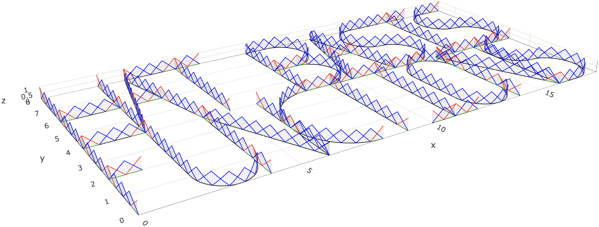

```{r setup, include=FALSE}
# Use the existing theme as-is: do not regenerate the shared CSS.
knitr::opts_chunk$set(echo=FALSE, message=FALSE, warning=FALSE,
  error=FALSE, cache=FALSE, fig.align="center", dpi=180,
  fig.width=9, fig.height=3.7, out.width="94%")
options(htmltools.dir.version=FALSE)
library(ggplot2)

# Small snapshots of the four saved experiments. No PDE runs at knit time.
results_dir <- "data_files/tuesdaymeeting2p"
r_m <- readRDS(file.path(results_dir, "isolated_m_results_K16.rds"))
read_error_snapshot <- function(file) {
  env <- new.env(parent=emptyenv())
  load(file.path(results_dir, file), envir=env)
  value <- env$errors_projected
  list(errors=value, parameters=attr(value, "parameters"))
}
r_tau <- read_error_snapshot("errors_projected_tau_mat_K16.RData")
r_h <- read_error_snapshot("errors_projected_h_mat_K16.RData")
r_rough <- readRDS(file.path(results_dir, "rough_h_as_in_mat_results.rds"))
alphas <- r_m$parameters$alpha_vector
initial_modes <- c(5L, 6L, 8:21)
stopifnot(length(alphas)==9L,
  isTRUE(all.equal(alphas, seq(0.9,1.7,0.1))),
  identical(r_m$parameters$initial_modes, initial_modes),
  identical(r_tau$parameters$initial_modes, initial_modes),
  identical(r_h$parameters$initial_modes, initial_modes),
  isTRUE(all.equal(r_tau$parameters$alpha, alphas)),
  isTRUE(all.equal(r_h$parameters$alpha, alphas)),
  isTRUE(all.equal(r_rough$parameters$alpha, alphas)),
  identical(dim(r_h$errors), c(5L,9L)),
  identical(dim(r_tau$errors), c(5L,9L)),
  identical(dim(r_rough$errors), c(5L,9L)),
  all(is.finite(r_m$results$error)), all(r_m$results$error>0),
  all(is.finite(r_tau$errors)), all(r_tau$errors>0),
  all(is.finite(r_h$errors)), all(r_h$errors>0),
  all(is.finite(r_rough$errors)), all(r_rough$errors>0))

fit_loglog <- function(errors, axis) apply(errors,2,function(e)
  unname(coef(lm(log10(e)~log10(axis)))[2]))
tau_rates <- fit_loglog(r_tau$errors,r_tau$parameters$axis)
h_rates <- fit_loglog(r_h$errors,r_h$parameters$axis)
rough_raw <- fit_loglog(r_rough$errors,r_rough$parameters$h)
rough_corrected <- fit_loglog(r_rough$errors*r_rough$parameters$J,
  r_rough$parameters$h)
fit_m <- function(d) {
  if(nrow(d)<2L) return(NA_real_)
  unname(coef(lm(log(error)~sqrt(m),data=d))[2])
}
m_rates <- do.call(rbind,lapply(alphas,function(a) {
  d <- r_m$results[abs(r_m$results$alpha-a)<1e-8,]
  data.frame(alpha=a, benchmark=-2*pi*sqrt(a/2),
    all=fit_m(d), resolved=fit_m(d[d$resolved,]), n=sum(d$resolved))
}))
alpha_colors <- setNames(scales::hue_pal()(length(alphas)),as.character(alphas))
plot_theme <- theme_bw(base_size=14) + theme(
  legend.position="bottom", legend.title=element_text(face="bold"),
  legend.margin=margin(0,0,0,0), legend.box.margin=margin(-3,0,0,0),
  plot.margin=margin(5,10,5,5), panel.grid.minor=element_blank(),
  text=element_text(colour="#272822"),
  axis.title=element_text(colour="#0D2244"))
alpha_scale <- function() scale_color_manual(values=alpha_colors,drop=FALSE,
  guide=guide_legend(nrow=1,byrow=TRUE))
convergence_plot <- function(errors,axis,powers,x_label,y_label,
                             model_factor=rep(1,length(axis))) {
  d <- expand.grid(row=seq_along(axis),column=seq_along(alphas))
  d$x <- axis[d$row]
  d$error <- as.vector(errors)
  d$alpha <- factor(alphas[d$column],levels=alphas)
  guide <- d
  for(j in seq_along(alphas)) {
    ids <- d$column==j
    model <- axis^rep(powers,length.out=length(alphas))[j]*model_factor
    guide$error[ids] <- mean(errors[,j]/model)*model
  }
  ggplot(d,aes(x,error,color=alpha,group=alpha)) +
    geom_line(data=guide,linetype="dashed",linewidth=0.5) +
    geom_line(linewidth=0.55)+geom_point(size=1.8)+
    scale_x_log10(breaks=sort(unique(axis)),
      labels=scales::label_number(accuracy=NULL))+
    scale_y_log10(labels=scales::label_scientific())+
    alpha_scale()+labs(x=x_label,y=y_label,color=expression(alpha))+
    plot_theme
}
```

layout: true
class: left, top

<div class="meeting-logos">
  
  
  
</div>

---

### Project 2 · Overview
*********

### Fractional diffusion on a metric graph

- Model, discrete operator, and regularity-dependent error estimate

- Rational approximation of the complete backward Euler update

### Updated numerical experiments

- Isolated rational convergence and smooth-data time and space convergence

- Rough forcing, unresolved modes, and the logarithmic spatial correction

???
Theory: /home/rierasl/Desktop/6ac76d140751a76e98ae4d0b/main.tex.
Numerical evidence: the four notebooks named on the final source slide.

---

### Project 2 · Overview
*********

```{r p5plotly, eval = TRUE, fig.height = 4.5, out.width = "100%"}
load(here::here("data_files/logo_five_diffusion_animation.RData"))
# Keep animation frames outside remark's slide source so the deck opens quickly.
widget_file <- here::here("data_files/logo_five_diffusion_animation.html")
local({
  widget_libdir <- tempfile("logo_diffusion_libs_", tmpdir=dirname(widget_file))
  on.exit(unlink(widget_libdir, recursive=TRUE), add=TRUE)
  htmlwidgets::saveWidget(logo_five_diffusion_animation, widget_file,
    selfcontained=TRUE, libdir=widget_libdir, title="Diffusion on the logo graph")
})
docs_widget_file <- here::here("docs", "data_files", basename(widget_file))
dir.create(dirname(docs_widget_file), recursive=TRUE, showWarnings=FALSE)
stopifnot(file.copy(widget_file, docs_widget_file, overwrite=TRUE))
htmltools::tags$iframe(
  src=file.path("data_files", basename(widget_file)), width="100%",
  height=round(knitr::opts_current$get("fig.height")*96),
  style="border:0; display:block;", loading="lazy",
  title="Interactive diffusion animation")
```

???
Think of this graph as a network of thin wires heated at five locations. After the heating stops, the temperature spreads along the wires and through their junctions. This illustrates ordinary diffusion on a graph. We then extend the mathematical model to fractional diffusion, which allows nonlocal transport across the network.

---

### Project 2 · Fractional diffusion
*********

```{r fractional-diffusion-animation, eval = TRUE, fig.height = 4.5, out.width = "100%"}
load(here::here("data_files/logo_five_fractional_diffusion_animation.RData"))
# Keep animation frames outside remark's slide source so the deck opens quickly.
fractional_widget_file <- here::here("data_files/logo_five_fractional_diffusion_animation.html")
local({
  fractional_widget_libdir <- tempfile("logo_diffusion_libs_", tmpdir=dirname(fractional_widget_file))
  on.exit(unlink(fractional_widget_libdir, recursive=TRUE), add=TRUE)
  htmlwidgets::saveWidget(logo_five_fractional_diffusion_animation, fractional_widget_file,
    selfcontained=TRUE, libdir=fractional_widget_libdir, title="Fractional diffusion on the logo graph")
})
fractional_docs_widget_file <- here::here("docs", "data_files", basename(fractional_widget_file))
dir.create(dirname(fractional_docs_widget_file), recursive=TRUE, showWarnings=FALSE)
stopifnot(file.copy(fractional_widget_file, fractional_docs_widget_file, overwrite=TRUE))
htmltools::tags$iframe(
  src=file.path("data_files", basename(fractional_widget_file)), width="100%",
  height=round(knitr::opts_current$get("fig.height")*96),
  style="border:0; display:block;", loading="lazy",
  title="Interactive fractional diffusion animation")
```

???
The same five Gaussian hot spots now evolve with alpha=1 and kappa=1: spatial fractional diffusion with decay. The temperature colors use a fixed scale, and kappa and alpha are displayed in the animation. Compare the h=0.1 solution with the independently computed h=1 solution; the coarse mesh nodes are marked.

---

### Project 2 · Problem setting
*********

.custom-box[
$$
\begin{cases}
\partial_tu(s,t)+\nu L^{\alpha/2}u(s,t)=f(s,t),
   &(s,t)\in\Gamma\times(0,T),\\
u(s,0)=u_0(s),&s\in\Gamma,
\end{cases}
\qquad L=\kappa^2-\Delta_\Gamma.
$$
]

- $\Gamma$ is a compact, connected metric graph and $\kappa>0$.
- $0<\alpha\le2$ is the spatial order. The experiments include $\nu>0$.
- $L$ encodes continuity and conservation of flux at graph vertices:
\begin{equation*}
u\text{ is continuous},\qquad
\sum_{e\sim v}\partial_eu(v)=0\quad\text{for }u\in D(L).
\end{equation*}

For fractional powers, vertex compatibility is encoded through the spectral domains of $L$.

???
Source: main.tex, Introduction and Notation and Preliminaries.
The paper's analysis uses nu=1. A fixed positive nu changes constants.
Avoid imposing classical pointwise derivative conditions on every low-regularity fractional-domain function.

---

### Project 2 · Functional framework
*********

Let $Le_j=\lambda_je_j$, where $\{e_j\}$ is orthonormal in $L_2(\Gamma)$.

.content-box-blue[
\begin{equation*}
L^{\alpha/2}v=\sum_j\lambda_j^{\alpha/2}(v,e_j)e_j,
\qquad
\|v\|_{\dot H^s(\Gamma)}^2=\sum_j\lambda_j^s|(v,e_j)|^2.
\end{equation*}
]

For $u_0\in\dot H^{\alpha/2}(\Gamma)$ and $f\in L_2(0,T;L_2(\Gamma))$,
the unique solution has the representation
\begin{equation*}
u(t)=e^{-\nu tL^{\alpha/2}}u_0+
\int_0^t e^{-\nu(t-r)L^{\alpha/2}}f(r)\,dr,
\end{equation*}
and satisfies
\begin{equation*}
u\in L_2(0,T;\dot H^\alpha)\cap H^1(0,T;L_2)
\cap C([0,T];\dot H^{\alpha/2}).
\end{equation*}

???
Source: main.tex, Theorem labelled theorem:existenceuniquenessandregularity, specialized to r=0.
The general theorem holds on the spectral scale for arbitrary r.

---

### Project 2 · Discretization
*********

**Space.** Continuous P1 finite elements $V_h$ on conforming, quasi-uniform graph meshes.
Define $L_h$ first, then take its fractional power:
\begin{equation*}
(L_hv_h,w_h)=\kappa^2(v_h,w_h)+(v_h',w_h'),
\qquad L_h^\beta\text{ by finite-dimensional spectral calculus},
\quad \beta=\alpha/2.
\end{equation*}

**Time.** Backward Euler with $\tau=T/N$, projected initial data, and averaged forcing:
.content-box-blue[
\begin{equation*}
(I+\tau\nu L_h^\beta)U_h^{k+1}
=U_h^k+\tau P_hf^{k+1},\qquad U_h^0=P_hu_0,
\end{equation*}
\begin{equation*}
f^{k+1}=\frac1\tau\int_{t_k}^{t_{k+1}}f(t)\,dt.
\end{equation*}
]

Use $U_h^\tau(t)=U_h^k$ for $t\in(t_{k-1},t_k]$ in the space–time norm.

???
Source: main.tex, Numerical approximation and system:fully_discrete_scheme.
This updates the older proposal slides: the discrete power is the power of L_h,
rather than a direct restriction of the continuous fractional energy form.

---

### Project 2 · Approximation estimates
*********

The analysis combines approximation on the spectral scale with stability of the projected data.

<div class="content-box-myblue">Fractional elliptic projection</div>
.content-box-blue[
\begin{equation*}
\|v-G_{h,\alpha}v\|_{L_2(\Gamma)}
\lesssim h^\alpha\|v\|_{\dot H^\alpha(\Gamma)},
\qquad 0<\alpha\le2.
\end{equation*}
]

<div class="content-box-myblue">Stability of the discrete fractional operator</div>
.content-box-blue[
\begin{equation*}
\|L_h^{\alpha/2}P_hv\|_{L_2(\Gamma)}
\lesssim\|L^{\alpha/2}v\|_{L_2(\Gamma)}.
\end{equation*}
]

The constants are uniform in $h$. The approximation argument also covers data for which nodal interpolation is unavailable.

???
Source: main.tex, Lemma lem:graph-fractional-fe-approx and Propositions
proposition:with_elliptic_projection and prop:controlofLhbyL.
G_{h,alpha} uses the continuous fractional energy form for the analysis.
It is distinct from constructing the discrete evolution with powers of L_h.

---

### Project 2 · Fully discrete error
*********

Assume $u_0\in\dot H^{s_0}(\Gamma)$, $s_0\ge\alpha/2$, and
$f\in L_2(0,T;\dot H^{s_f}(\Gamma))$, $s_f\ge0$.

<div class="content-box-myblue">Error estimate for 0 &lt; α &lt; 2</div>
.content-box-blue[
\begin{equation*}
\|u-U_{h,m}^\tau\|_{L_2(0,T;L_2(\Gamma))}
\lesssim \tau+h^{q-\epsilon}+e^{-2\pi\sqrt{(\alpha/2)m}},
\end{equation*}
\begin{equation*}
q=\min\{s_0+\alpha/2,\ s_f+\alpha,\ 2\},
\qquad \epsilon>0\text{ sufficiently small}.
\end{equation*}
]

- Smooth finite spectral sums permit $q=2$.
- Minimal initial regularity and $L_2$ forcing give $q=\alpha$.
- At $\alpha=2$, the rational representation is exact and the bound is $\tau+h^2$.

???
Source: main.tex, Theorem lastlasttheorem, equation finalfinalest.
The stated exponential term assumes the best uniform rational approximation quality.
Installed, sometimes interpolated, BRASIL coefficients are assessed numerically against this benchmark.
Data norms, nu, kappa, and T enter the hidden constant.

---

### Project 2 · Rational approximation
*********

Set $A_h=L_h/\kappa^2$ and $\beta=\alpha/2$. Then
$\sigma(A_h^{-1})\subset[\delta_h,1]$.

.custom-box[
\begin{equation*}
r_m(x)\approx x^\beta\quad\text{on }[0,1],\qquad
\delta_m=\sup_{[0,1]}|x^\beta-r_m(x)|
\lesssim e^{-2\pi\sqrt{\beta m}}.
\end{equation*}
]

With $R_{h,m}=r_m(A_h^{-1})$ and $s=\tau\nu\kappa^{2\beta}$,
\begin{equation*}
(R_{h,m}+sI)U_{h,m}^{k+1}
=R_{h,m}(U_{h,m}^k+\tau P_hf^{k+1}).
\end{equation*}

The source coefficients can be reused across meshes. The complete time-step rational function depends on $s$, hence on $\tau$ and $\nu$.

???
Sources: main.tex, Rational approximation; conv_in_m_isolated.Rmd, Steps 2 and 5.
r_m is type (m,m). BRASIL tables can interpolate coefficients in beta.
The best-approximation rate is a benchmark for those numerical coefficients,
not a certified bound for every interpolated approximant.

---

### Project 2 · Shifted sparse solves
*********

Write the source approximation and the time-step function as
\begin{equation*}
S_m(y)=r_m(y^{-1})=d_m+\sum_{j=1}^m\frac{\rho_j}{y-\eta_j},
\qquad
H_m(y)=\frac{S_m(y)}{S_m(y)+s}
=r_\tau+\sum_{n=1}^m\frac{a_n}{y-z_n},
\end{equation*}
where $r_\tau=d_m/(d_m+s)$, $z_n<0$, and $a_n>0$.

.content-box-blue[
\begin{equation*}
\mathbf U^{k+1}_{h,m}=\left[
r_\tau\mathbf C^{-1}+\sum_{n=1}^m a_n
(\mathbf L/\kappa^2-z_n\mathbf C)^{-1}\right]
(\mathbf C\mathbf U^k_{h,m}+\tau\mathbf F^{k+1}),
\end{equation*}
\begin{equation*}
\mathbf C_{ij}=(\psi_j,\psi_i),\quad
\mathbf G_{ij}=(\psi_j',\psi_i'),\quad
\mathbf L=\kappa^2\mathbf C+\mathbf G.
\end{equation*}
]

**Retain the constant-term mass solve.** Factorizations of the $m$ shifted matrices and $\mathbf C$ are reusable within a run.

???
Sources: main.tex, thenumericalscheme; all four notebooks, matrix method.
The actual update contains m shifted elliptic solves plus the constant mass solve.
Source poles eta_j and time-step poles z_n are different.
This replaces the older proposal claim that the remainder vanishes.
No eigenpairs are required for the production rational evolution.

---

### Experiments · Common setting
*********

.pull-left[
All four studies use the **tadpole graph** with stem length $1$ and loop length $2$.

\begin{equation*}
T=1,\qquad\kappa=4,
\end{equation*}
\begin{equation*}
\alpha\in\{0.9,1.0,\ldots,1.7\}.
\end{equation*}

The exact eigenfunctions define the data and reference solution. The FEM evolution uses shifted sparse solves.
]

.pull-right[
```{r tadpole-basis, out.width="100%"}

```
.meeting-caption[
Continuous P1 basis functions on the tadpole graph.
]
]

???
Sources: the four notebook problem statements; existing proposal asset data_files/basis.png.
The graph is the same in the rational, temporal, smooth spatial, and rough spatial studies.

---

### Experiments · Smooth data
*********

The updated initial condition contains **16 normalized modes**:
\begin{equation*}
u_0=\frac{10}{\sqrt{16}}\sum_{j\in\mathcal J_{16}}e_j,
\qquad\mathcal J_{16}=\{5,6,8,\ldots,21\},
\qquad f(t)=10\sin(\pi t)e_7.
\end{equation*}

With $\gamma_j=\nu\lambda_j^{\alpha/2}$, the exact solution is
.content-box-blue[
\begin{equation*}
u(s,t)=\frac{10}{\sqrt{16}}\sum_{j\in\mathcal J_{16}}
e^{-\gamma_jt}e_j(s)+c_7(t)e_7(s),
\end{equation*}
\begin{equation*}
c_7(t)=\frac{10}{\gamma_7^2+\pi^2}
\left[\gamma_7\sin(\pi t)-\pi\cos(\pi t)+\pi e^{-\gamma_7t}\right].
\end{equation*}
]

$\|u_0\|_{L_2}=10$. All 17 active solution modes are included in the reference, and both data have arbitrarily high spectral spatial regularity.

???
Sources: conv_in_m_isolated.Rmd, conv_in_tau_mat.Rmd, cov_in_h_mat.Rmd;
the saved K16 metadata agree across these studies.
The manuscript still describes the earlier initial condition 10 e_5.

---

### Experiments · Error norms
*********

**Time and space studies:** approximate the total continuum error using exact solution values on a fixed reference grid.
\begin{equation*}
E_{\rm sampled}^2=\tau_\star\sum_{\ell=1}^{N_\star}
\mathbf d_\ell^\top\mathbf C^\star\mathbf d_\ell,
\qquad
\mathbf d_\ell=\mathbf u^\star(t_\ell^\star)
-\boldsymbol\Psi\mathbf U^{k(\ell)}_{h,m}.
\end{equation*}
Here $t_\ell^\star\in(t_{k(\ell)-1},t_{k(\ell)}]$ and
$\Psi_{ij}=\psi_j(s_i^\star)$.

**Rational study:** compare two FEM trajectories on the same mesh and time grid.
.content-box-blue[
\begin{equation*}
E_m^2=\tau\sum_{k=1}^N
(\mathbf U_h^k-\mathbf U_{h,m}^k)^\top\mathbf C
(\mathbf U_h^k-\mathbf U_{h,m}^k).
\end{equation*}
]

The sampled norm uses reference quadrature. The isolated rational norm integrates both right-constant FEM trajectories exactly in time.

???
Sources: conv_in_tau_mat.Rmd and cov_in_h_mat.Rmd, Error computation;
conv_in_m_isolated.Rmd, Step 3; cov_in_h_rough_as_in_mat.Rmd, sampled norm.
The rough reference is a finite-series reference u_K, with separate tail control.

---

### Rational study · Independent reference
*********

Fix $h=0.02$, $\tau=0.005$, and $\nu=1$. Vary $m=2,\ldots,16$.

Use the **complete numerical eigensystem** for the reference:
\begin{equation*}
\mathbf L\mathbf V=\mathbf C\mathbf V\boldsymbol\Lambda,
\qquad \mathbf V^\top\mathbf C\mathbf V=\mathbf I,
\end{equation*}
\begin{equation*}
\mathbf U_h^{k+1}=\mathbf V\operatorname{diag}
\left((1+\tau\nu\lambda_{j,h}^{\alpha/2})^{-1}\right)
\mathbf V^\top(\mathbf C\mathbf U_h^k+\tau\mathbf F^{k+1}).
\end{equation*}

Both trajectories use the same projected initial value and averaged forcing.

.custom-box[
Their difference isolates the rational change to the discrete propagator. Shared FEM and backward Euler errors do not create a continuum error floor in $E_m$.
]

???
Source: conv_in_m_isolated.Rmd, Steps 1–4 and saved isolated_m_results_K16.rds.
All 150 numerical modes are retained in the reference, not only the active continuum modes.
The sparse solve trajectory is independently checked against scalar rational propagation in this basis.

---

### Rational study · Convergence in m
*********

.meeting-figure[
```{r isolated-m, fig.height=3.7}
d <- r_m$results
d$alpha_label <- factor(d$alpha,levels=alphas)
guide <- d
for(a in alphas) {
  ids <- abs(d$alpha-a)<1e-8
  model <- exp(-2*pi*sqrt(a/2)*sqrt(d$m[ids]))
  guide$error[ids] <- mean(d$error[ids]/model)*model
}
ggplot(d,aes(sqrt(m),error,color=alpha_label,group=alpha_label))+
  geom_line(data=guide,linetype="dashed",linewidth=0.5)+
  geom_line(linewidth=0.6)+geom_point(aes(shape=resolved),size=1.8)+
  scale_shape_manual(values=c(`FALSE`=1,`TRUE`=16),guide="none")+
  scale_x_continuous(breaks=sqrt(2:16),labels=2:16)+
  scale_y_continuous(trans=scales::log_trans(base=exp(1)),
    breaks=10^seq(-12,0,2),labels=scales::label_scientific())+
  alpha_scale()+labs(x="m (square-root positions)",
    y="Isolated space–time L2 error",color=expression(alpha))+
  plot_theme
```
]

.meeting-caption[
Dashed curves: $C_\alpha e^{-2\pi\sqrt{(\alpha/2)m}}$. Filled markers pass the notebook's empirical resolution criterion.
]

???
Source: conv_in_m_isolated.Rmd, matrix-figure, using the saved K16 results.
Guides average the prescribed model curves anchored at all measured points.
The natural-log regression is against sqrt(m).

---

### Rational study · Regression slopes
*********

Fit $\ln E_m=s_m\sqrt m+b_m$. Compare with $c_\alpha=-2\pi\sqrt{\alpha/2}$.

.meeting-table[
```{r rational-slopes, results='asis'}
knitr::kable(m_rates[,c("alpha","benchmark","all","resolved","n")],
  digits=c(1,4,4,4,0),col.names=c("α","Benchmark","All orders","Resolved only","Resolved / 15"))
```
]

All `r nrow(r_m$results)` cases pass the empirical resolution criterion. The $\alpha=2$ control error is `r formatC(r_m$control$error,format="e",digits=2)`.

The benchmark is an upper-bound scale. A finite-range fitted slope need not equal its exponent.

???
Source: isolated_m_results_K16.rds. Slopes are recomputed from the saved errors.
Resolution criterion: product_error > 100 max(absolute_error_disagreement,
alpha=2 control error, double.xmin). It is empirical, not a roundoff certificate.
All-order and resolved-only slopes coincide because all saved cases pass.

---

### Smooth data · Convergence in time
*********

$h=10^{-3}$, $m=8$, $\nu=10^{-3}$.
Vary $\tau=1/N$ for $N\in\{200,63,20,6,2\}$.

.meeting-figure[
```{r temporal-convergence, fig.height=3.4}
convergence_plot(r_tau$errors,r_tau$parameters$axis,1,
  expression(tau),"Sampled space–time L2 error")
```
]

.meeting-caption[
Dashed curves: $C_\alpha\tau$. Observed slopes range from `r sprintf("%.4f",min(tau_rates))` to `r sprintf("%.4f",max(tau_rates))`. Reference resolutions: $h_\star=\tau_\star=10^{-5}$.
]

???
Source: conv_in_tau_mat.Rmd, parameters, plot-results, rates;
errors_projected_tau_mat_K16.RData. Actual integer-step time grids are used.
The forcing is averaged analytically on each time step.

---

### Smooth data · Convergence in space
*********

$\tau=2\cdot10^{-5}$, $m=8$, $\nu=10^{-3}$.
Vary $h\in\{1/512,1/256,1/128,1/64,1/32\}$.

.meeting-figure[
```{r smooth-spatial-convergence, fig.height=3.4}
convergence_plot(r_h$errors,r_h$parameters$axis,2,
  "h","Sampled space–time L2 error")+
  scale_x_log10(breaks=r_h$parameters$axis,
    labels=paste0("1/",round(1/r_h$parameters$axis)))
```
]

.meeting-caption[
Dashed curves: $C_\alpha h^2$. Smooth spectral data permit the P1 spatial limit. Reference resolutions: $h_\star=\tau_\star=10^{-5}$.
]

???
Source: cov_in_h_mat.Rmd, parameters, plot-results, rates;
errors_projected_h_mat_K16.RData.
The current saved mesh range differs from the range still stated in the paper.
The theorem permits h^(2-epsilon) for sufficiently small positive epsilon.
The plotted h^2 guides are comparison curves, not certified bounds.

---

### Smooth data · Observed rates
*********

.meeting-table[
```{r smooth-rates, results='asis'}
knitr::kable(data.frame(alpha=alphas,spatial=h_rates,temporal=tau_rates),
  digits=c(1,5,5),col.names=c("α","Spatial slope, reference 2","Temporal slope, reference 1"))
```
]

.custom-box[
The smooth-data experiments support second-order spatial and first-order temporal convergence across the tested fractional orders.
]

???
Sources: errors_projected_h_mat_K16.RData and errors_projected_tau_mat_K16.RData.
Both regressions use log10(error) against log10(the saved refinement axis).
Finite-mode data cannot reveal the minimal-regularity alpha-dependent spatial order.

---

### Rough forcing · Data and regularity
*********

Set $u_0=0$ and use the same infinite forcing on every mesh:
.custom-box[
\begin{equation*}
g=\sum_{j=1}^\infty\frac{\phi_j}{j},\qquad
\phi_j=0\text{ on the stem},\qquad
\phi_j(x)=\sin(2^j\pi x)\text{ on the loop }[0,2].
\end{equation*}
]

These orthonormal Kirchhoff modes have $\mu_j=\kappa^2+\pi^2 2^{2j}$, so
\begin{equation*}
\|g\|_{L_2}^2=\sum_jj^{-2}<\infty,
\qquad \|g\|_{\dot H^s}^2=\sum_jj^{-2}\mu_j^s=\infty\quad(s>0).
\end{equation*}

With $a_j=\nu\mu_j^{\alpha/2}$, the exact solution is
\begin{equation*}
u(t)=\sum_{j=1}^\infty b_j(t)\phi_j,\qquad b_j(t)=\frac{1-e^{-a_jt}}{ja_j}.
\end{equation*}

???
Source: cov_in_h_rough_as_in_mat.Rmd, The experiment and Step 1.
Here delta_m denotes the rational approximation-error scale.
u_0=0 allows arbitrary s_0, while the forcing allows only s_f=0.

---

### Rough forcing · Unresolved modes
*********

On the aligned dyadic mesh $h_J=2^{-J}$, analytic sine–hat integrals satisfy
\begin{equation*}
(\phi_j,\psi_i)=0\quad\text{for every FEM hat and every }j\ge J.
\end{equation*}

The original infinite forcing therefore has the **exact finite load**
\begin{equation*}
\mathbf F_i=\sum_{j=1}^{J-1}\frac{(\phi_j,\psi_i)}{j}.
\end{equation*}

Split $u=u_{<J}+u_{\ge J}$. Orthogonality gives
.content-box-blue[
\begin{equation*}
E_{h_J}^2=\|u_{<J}-U_{h_J,m}^\tau\|_{L_2(0,T;L_2)}^2
+E_{\rm tail}^2,
\qquad E_{\rm tail}^2=\sum_{j=J}^\infty\int_0^T b_j(t)^2\,dt.
\end{equation*}
]

Unresolved modes remain in the continuum solution. Their orthogonality to $V_h$ gives a lower bound on the total error.

???
Source: cov_in_h_rough_as_in_mat.Rmd, Steps 2–5.
The tail starts at j=J, including that index. Squared norms add in this identity.
Modes below J have nonzero projections but are not represented exactly by P1 functions.

---

### Rough forcing · Logarithmic correction
*********

Since $a_j\asymp2^{\alpha j}$, the unresolved tail satisfies
\begin{equation*}
E_{\rm tail}^2\asymp\sum_{j=J}^\infty\frac{2^{-2\alpha j}}{j^2},
\qquad
E_{\rm tail}\asymp\frac{h_J^\alpha}{J}
=\frac{h_J^\alpha}{\log_2(1/h_J)}.
\end{equation*}

If this contribution controls the measured error, then
\begin{equation*}
\log_2\frac{E_{h_J}}{E_{h_{J+1}}}
\approx\alpha+\log_2\frac{J+1}{J}>\alpha.
\end{equation*}

.custom-box[
Compare the raw errors with $C_\alpha h_J^\alpha/J$, and fit
\begin{equation*}
\log_{10}(JE_{h_J})=s_{\rm corrected}\log_{10}h_J+b
\end{equation*}
to compare the corrected slope with $\alpha$.
]

???
Source: cov_in_h_rough_as_in_mat.Rmd, Steps 8–9.
The tail gives a lower bound and motivates the model; it does not prove
a matching upper bound for every contribution to the total error.
The logarithm is specific to this forcing's amplitudes 1/j.
Multiplication by J changes the rate comparison, not the underlying error norm.

---

### Rough forcing · Raw spatial error
*********

$\nu=1$, $m=14$, $\tau=8\cdot10^{-7}$.
Use $J=5,\ldots,9$, with $h_J=2^{-J}$.

.meeting-figure[
```{r rough-raw, fig.height=3.4}
convergence_plot(r_rough$errors,r_rough$parameters$h,alphas,
  "h","Sampled space–time L2 error",1/r_rough$parameters$J)+
  scale_x_log10(breaks=sort(r_rough$parameters$h),
    labels=function(x)paste0("1/",round(1/x)))
```
]

.meeting-caption[
Dashed curves: $C_\alpha h^\alpha/J$. The sampled reference uses cutoff $K=16$, $h_\star=2^{-18}$, and $\tau_\star=10^{-5}$.
]

???
Source: cov_in_h_rough_as_in_mat.Rmd and rough_h_as_in_mat_results.rds,
generated_at 2026-11-04 17:32:27 +03. All 45 cases use the same solver time step.
The bound B_K is not added to any plotted error.

---

### Rough forcing · Corrected spatial error
*********

The same sampled errors, multiplied by $J=\log_2(1/h)$.

.meeting-figure[
```{r rough-corrected, fig.height=3.5}
convergence_plot(r_rough$errors*r_rough$parameters$J,
  r_rough$parameters$h,alphas,"h","J × sampled L2 error")+
  scale_x_log10(breaks=sort(r_rough$parameters$h),
    labels=function(x)paste0("1/",round(1/x)))
```
]

.meeting-caption[
Dashed curves: $C_\alpha h^\alpha$. This forcing-specific correction removes the leading logarithmic factor from the comparison.
]

???
Source: cov_in_h_rough_as_in_mat.Rmd, corrected-figure and rates;
rough_h_as_in_mat_results.rds. Guide constants average all measured/model ratios.
No theoretical tail sum or bound is added to the sampled norm.

---

### Rough forcing · Observed rates
*********

.meeting-table[
```{r rough-rates, results='asis'}
knitr::kable(data.frame(alpha=alphas,raw=rough_raw,corrected=rough_corrected,
  difference=rough_corrected-alphas),digits=c(1,5,5,5),
  col.names=c("α","Raw slope","Corrected slope","Corrected − α"))
```
]

The corrected slopes are within `r sprintf("%.3f",max(abs(rough_corrected-alphas)))` of $\alpha$.
The largest omitted-tail bound is `r sprintf("%.4f",100*max(r_rough$max_tail_squared_fraction))`% of the measured squared error.

Time-refinement checks for all nine fractional orders are still pending in the notebook.

???
Source: rough_h_as_in_mat_results.rds and cov_in_h_rough_as_in_mat.Rmd,
Parameters and Checks for the original eight-alpha run.
The original eight-alpha checks do not establish completed time refinement for the present nine-alpha grid.
At alpha near 2, a lower-mode h^2 contribution can be slow to separate from h^alpha/J.
That possibility alone does not establish the cause of a particular fitted slope.

---

### Project 2 · Discussion
*********

<div class="content-box-myblue">Numerical evidence</div>
.content-box-blue[
- The isolated rational error follows the root-exponential scale across $m=2,\ldots,16$.
- Smooth finite-mode data give spatial slopes near $2$ and temporal slopes near $1$.
- Rough $L_2$ forcing reveals the $\alpha$-dependent spatial order after the logarithmic correction.
]

**Interpretation.** Data regularity determines the spatial rate. The studies measure different error contributions and need separate reference constructions.

**Next numerical check.** Complete solver-time refinement for the current rough-data grid, keeping reference quadrature and truncation checks separate.

???
Sources: saved outputs of all four requested notebooks and their rate discussions.
Numerical slopes support the estimates over the tested ranges; they do not prove asymptotic sharpness.
Coefficient interpolation means the ideal rational rate remains a benchmark rather than an automatic certificate.

---
class: center, middle

## Additional details
*********

# Experiment updates and accuracy checks

*********

---
class: left, top

### Appendix · Changes from the paper
*********

.meeting-table.meeting-small[
| Item | Current manuscript | Notebook results used here |
|:---|:---|:---|
| Smooth initial data | $10e_5$ | $10\sum_{j\in\mathcal J_{16}}e_j/\sqrt{16}$ |
| Rational orders | $m=2,\ldots,8$ | $m=2,\ldots,16$ |
| Smooth spatial meshes | $1/128,\ldots,1/8$ | $1/512,\ldots,1/32$ |
| Smooth spatial slopes | About 2.0155 | About 2.0092–2.0101 |
| Rational fits | Earlier $m$ regression | All-order and resolved-only regressions |
]

The temporal slopes also change slightly with the updated smooth data.
The saved rough-data results retain the stated fixed solver time step and logarithmically corrected rates.

???
Sources: main.tex, Numerical experiments and Table tab:num-rates;
saved K16 results and rough_h_as_in_mat_results.rds.
The paper source is not changed by this presentation.

---

### Appendix · Accuracy diagnostics
*********

**Isolated rational study**

- Complete numerical spectrum: `r r_m$diagnostics$dimension` modes.
- Eigen-equation relative residual: `r formatC(r_m$diagnostics$relative_residual,format="e",digits=2)`.
- Mass orthogonality error: `r formatC(r_m$diagnostics$C_orthogonality_error,format="e",digits=2)`.
- Compare sparse rational propagation with scalar propagation in the full numerical eigenbasis.

**Rough spatial study**

- Fixed cutoff $K=16\ge\max J-1$ preserves the infinite forcing's FEM load.
- $h_\star=2^{-18}$ resolves the highest retained frequency.
- The omitted-tail bound is below the $0.2\%$ squared-error budget.
- Earlier diagnostics for eight fractional orders include reference and solver refinements. Solver-time refinement for all nine orders remains pending.

???
Sources: isolated_m_results_K16.rds diagnostics and control;
cov_in_h_rough_as_in_mat.Rmd, Error computation and final checks section.
The empirical resolution indicator is not a rigorous floating-point certificate.

---

### Appendix · Reference truncation
*********

The rough-data reference is the finite series
\begin{equation*}
u_K(t)=\sum_{j=1}^K\frac{1-e^{-a_jt}}{ja_j}\phi_j.
\end{equation*}

For $K\ge\max J-1$, orthogonality gives, in the continuum norm,
\begin{equation*}
\|u-U_h^\tau\|^2=\|u_K-U_h^\tau\|^2+\|u-u_K\|^2.
\end{equation*}

.content-box-blue[
\begin{equation*}
\|u-u_K\|^2\le B_K:=
\frac{T}{\nu^2\pi^{2\alpha}}
\frac{2^{-2\alpha(K+1)}}{(K+1)^2(1-2^{-2\alpha})}.
\end{equation*}
]

The reported errors approximate $\|u_K-U_h^\tau\|$ through reference-mass and reference-time quadrature. **The code records $B_K$ as a diagnostic and does not add it to the measured errors.**

???
Source: cov_in_h_rough_as_in_mat.Rmd, Step 6 and finite-reference discussion.
All unlabelled norms on this slide are L2(0,T;L2(Gamma)) norms.
The exact orthogonal identity applies to the continuum norm, not literally to its sampled approximation.

---

### Appendix · Sources
*********

.meeting-source[
**Paper and reference style**

- `/home/rierasl/Desktop/6ac76d140751a76e98ae4d0b/main.tex`
- `proposalPresentation.Rmd`, Project 2 and shared theme assets

**Updated experiments in `/home/rierasl/Desktop/NAP/`**

- `conv_in_m_isolated.Rmd` — isolated rational error, K16 data
- `conv_in_tau_mat.Rmd` — smooth temporal convergence, K16 data
- `cov_in_h_mat.Rmd` — smooth spatial convergence, K16 data
- `cov_in_h_rough_as_in_mat.Rmd` — rough spatial convergence and correction

Saved result snapshots and source hashes: `data_files/tuesdaymeeting2p/`.
]

???
The four local snapshots preserve the notebook output as inspected for this presentation.
All numerical slopes in the slides are calculated from those saved errors at knit time.
The R Markdown uses local snapshots and shared reference assets without sourcing or modifying the original notebooks.
